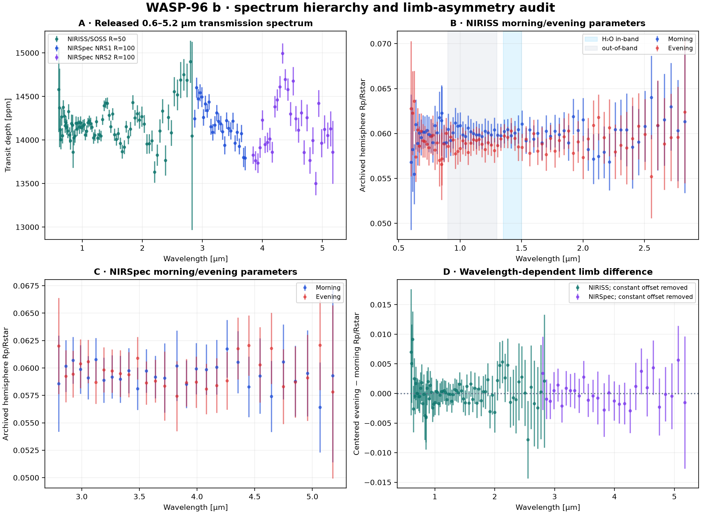

# WASP-96 b — spectrum hierarchy and limb-asymmetry audit

**Independent reproducibility report by [Biswajit Jana](https://biswajit1999.github.io/Biswajit_Jana.github.io/)** · [Live report](https://biswajit1999.github.io/wasp-96b-exoplanet-report/) · [ORCID](https://orcid.org/0009-0002-2411-1891)

This repository audits the complete transmission-spectrum subset of the public
WASP-96 b supplementary archive: 12 NIRISS/SOSS and NIRSpec/G395H products at
R=50, R=100, R=300, and native/pixel sampling, including separate morning and
evening limb fits. The source paper remains authoritative for retrieval and
limb-asymmetry inference.

## What the complete archive changes

The earlier version used two selected CSVs and reduced limb asymmetry to the
weighted mean of evening-minus-morning values. That statistic answers only
whether the two fitted limb spectra have a constant offset. A constant offset
is not the same as wavelength-dependent atmospheric asymmetry and is strongly
coupled to the transit mid-time.

The complete audit separates three questions:

1. **Broad spectrum:** the 0.6–5.2 µm products visibly contain H2O and CO2
   structure; the paper's multi-code retrievals also constrain Na.
2. **Constant limb offset:** under an explicitly incomplete independence
   assumption, the NIRISS mean evening-minus-morning offset is −0.001009 ±
   0.000297 in the archived hemisphere parameter (−3.40 sigma-like), while the
   NIRSpec value is 0.04 sigma-like. This is a nuisance diagnostic, not an
   atmospheric detection.
3. **Water-band shape:** using the paper's 1.35–1.50 µm in-band and 0.90–1.30
   µm out-of-band definitions, the archived marginal errors alone yield a
   0.78 sigma-like evening-minus-morning amplitude difference. The paper's
   light-curve injection/recovery experiment instead reports 2.6σ.

The last discrepancy is expected to matter: morning and evening radii are
jointly inferred from the same light curves, but their covariance is not in the
released CSVs. Marginal errors added in quadrature cannot reconstruct the
published experiment. The defensible conclusion is therefore the paper's:
the water-band asymmetry is tentative, and limb asymmetry is not conclusive.



## Reproduce

```bash
python -m pip install -r requirements.txt
python scripts/validate_sources.py
python scripts/analyze_spectrum.py
pytest -q
ruff check .
```

Outputs include
[`analysis_summary.json`](figures/analysis_summary.json),
[`resolution_inventory.csv`](figures/resolution_inventory.csv), and
[`limb_differences.csv`](figures/limb_differences.csv).

## Provenance and limitations

- `data/transmission_products/` contains all 12 transmission-spectrum CSVs
  from Zenodo record 17065171. The archive MD5 and a cross-platform product-set
  SHA-256 digest are validated before analysis.
- The simple ratios assume independent Gaussian marginal errors. They omit
  inter-limb, inter-wavelength, and reduction covariance.
- NIRISS reductions diverge beyond approximately 1.7 µm depending on 1/f-noise
  correction. The paper demonstrates that integration-level correction can
  inject a slope and excess covariance; this repository does not erase that
  reduction-choice uncertainty.
- The spectrum products alone cannot reproduce atmospheric retrieval Bayes
  factors, abundance posteriors, or injection/recovery distributions.

## Scientific reference

Radica, M. et al. (2026), “Super-Solar Metallicity and Tentative Evidence for
Photochemistry on WASP-96 b from JWST and Ground-Based VLT Transmission
Spectroscopy,” accepted to *The Astronomical Journal*,
[arXiv:2604.05049](https://arxiv.org/abs/2604.05049). Data:
[Zenodo 17065171](https://doi.org/10.5281/zenodo.17065171).

## Author

Biswajit Jana — [Portfolio](https://biswajit1999.github.io/Biswajit_Jana.github.io/) · [GitHub](https://github.com/Biswajit1999) · [ORCID](https://orcid.org/0009-0002-2411-1891)
